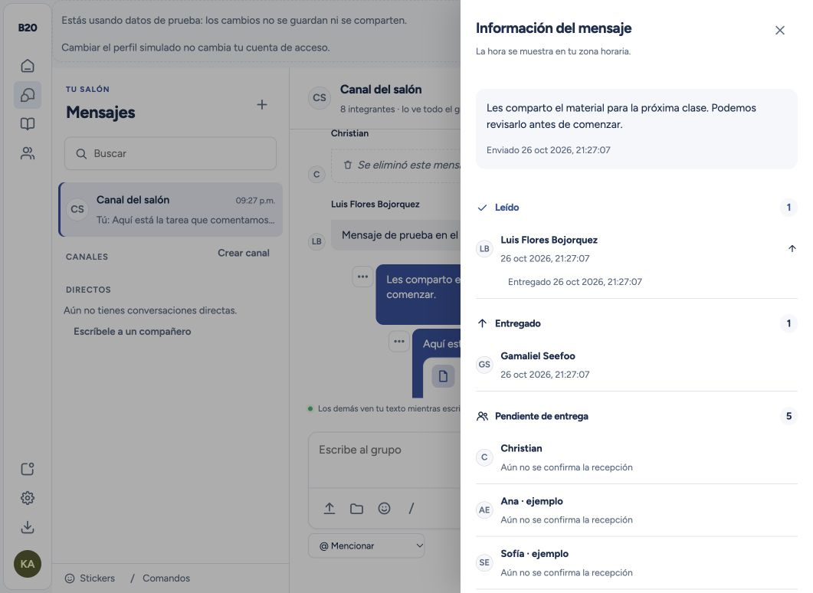
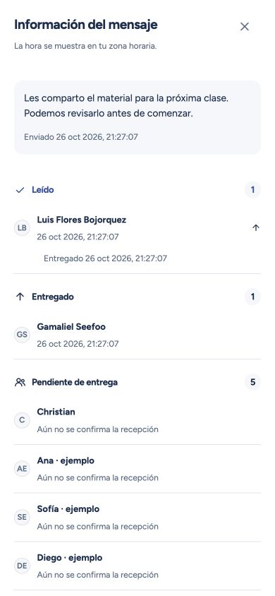
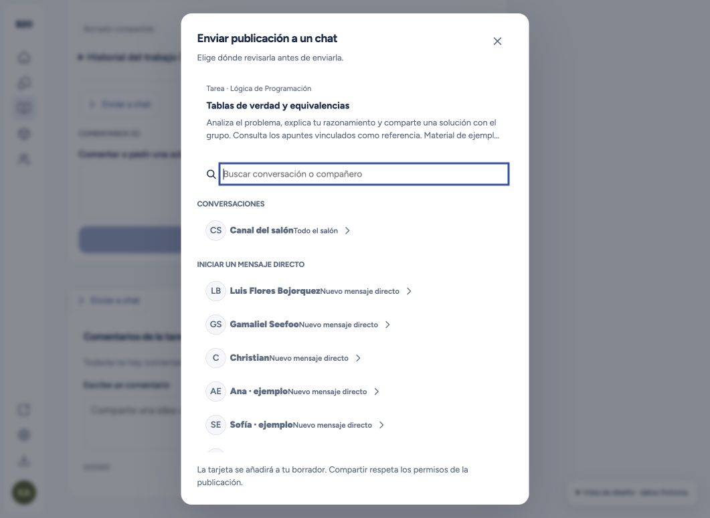
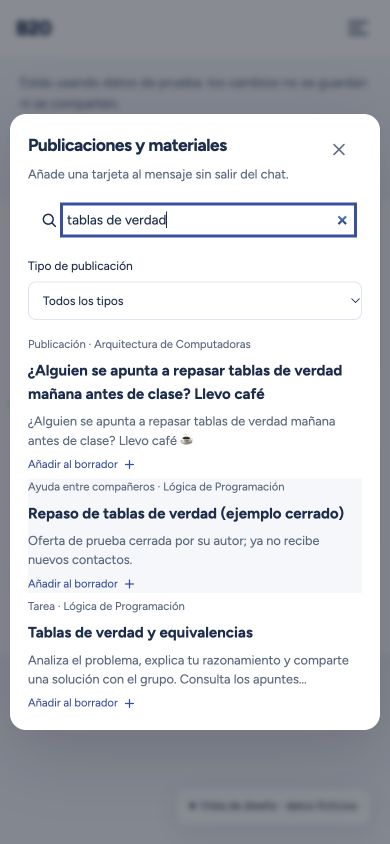
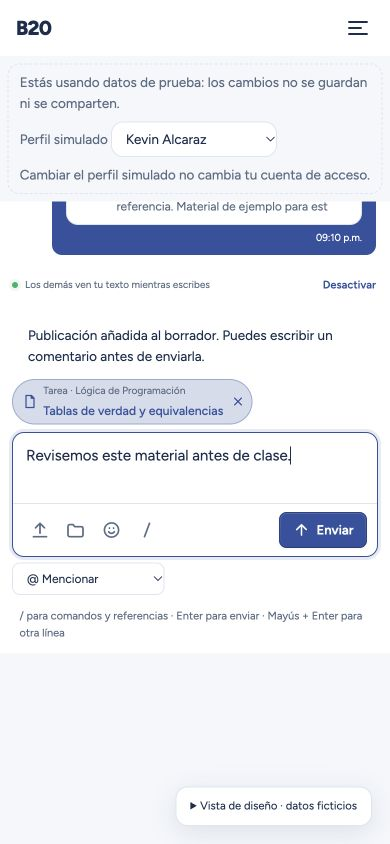

# Información de mensajes y publicaciones compartidas

Esta entrega añade información de lectura y envío interno de publicaciones al módulo de Mensajes. Las comprobaciones y capturas de esta página utilizan datos ficticios.

## Información del mensaje

El autor abre **Información del mensaje** desde los tres puntos de cualquier mensaje propio. El panel se actualiza mientras está abierto y agrupa a los destinatarios en **Leído**, **Entregado** y **Pendiente de entrega**. Al desplegar una lectura también aparece la primera entrega. Las fechas proceden del servidor y se presentan en la zona horaria del dispositivo.

La entrega se confirma cuando una sesión aplica el mensaje a su caché. La lectura exige un segundo continuo de visibilidad de la burbuja con la ventana activa. Salir del chat, ocultar la pestaña o perder el foco cancela el temporizador; las burbujas largas se evalúan contra la altura disponible. Los reintentos y las sesiones adicionales conservan las primeras fechas.

Los destinatarios se fijan al enviar y excluyen al autor. Las incorporaciones posteriores no generan pendientes retroactivos. Los históricos indican **Sin registro anterior** y solo incorporan nuevas confirmaciones observadas. El cursor anterior sigue siendo compatible y no se interpreta como una hora de lectura.

Las tablas de seguimiento son privadas. Cada destinatario recibe exclusivamente sus propios estados; únicamente el autor puede consultar el detalle de destinatarios. Administrar el salón no permite leer estados de directos ajenos. La purga del mensaje elimina sus recibos.

## Publicaciones en chat

**Enviar a chat** permite elegir el salón, un canal o un directo existente, o iniciar un directo. La tarjeta se añade al borrador para revisarla antes de enviar. **Publicaciones y materiales** ofrece el mismo catálogo desde el compositor. Los borradores mantienen texto, referencias y archivos por cuenta y conversación, únicamente en memoria.

El catálogo cubre los veinte tipos del feed y los diccionarios publicados de Señales. La integración de proyectos visuales compartidos es opcional y se activa cuando el módulo está disponible. La tarjeta muestra tipo, título y contexto y abre el recurso exacto, incluidos respuestas, evidencias, soluciones y observaciones.

El servidor calcula la ruta y comprueba los permisos en cada consulta. Compartir no publica contenidos privados ni concede permisos nuevos. Una publicación retirada o inaccesible aparece como **Publicación no disponible**. Elegir un destino interno no crea enlaces públicos ni vistas previas externas.

Las referencias anteriores siguen disponibles. El formato adicional `[[recurso:<base64url>]]` utiliza una carga versionada y admite identificadores compuestos. Cada intención de compartir se consume una sola vez para evitar repetir tarjetas al volver atrás.

## Validación y conservación

La prueba reproducible `npm run test:spacetime:message-info` inicia un servidor aislado con varias conexiones y datos sintéticos. Comprueba la entrega desde caché, estados pendientes, privacidad, fechas inmutables entre sesiones, incorporaciones posteriores, tarjetas en salón/canal/directo y persistencia tras reiniciar.

Las pruebas automatizadas adicionales cubren los veinte tipos del feed, Señales y la integración opcional visual; rutas específicas y permisos; selector, borradores y archivos; información histórica; visibilidad continua durante un segundo y mensajes largos; sustitución de cuenta y navegación sin duplicados.

La publicación se prepara desde una copia aislada que conserva la versión existente de Señales y excluye la activación del Laboratorio visual en desarrollo. Se compara el esquema del servidor publicado y se ensaya la actualización sobre datos sintéticos ya poblados antes de publicar primero el servidor compatible y después el cliente. Las huellas de producción comparan tablas y registros sin guardar contenido de los usuarios en los comprobantes.

Publicado y verificado el **26 de octubre de 2026** en [b20.mx](https://b20.mx/#/m/mensajes). Se publicó primero el servidor compatible y después la interfaz.

- **2,415 pruebas aprobadas:** 1,298 de interfaz, 248 de core, 540 de servidor, 265 de API y 64 de web. La suite de interfaz se ejecutó con dos trabajadores y un límite de 15 segundos por prueba para controlar la carga del equipo.
- Tipos aprobados en todos los paquetes. Compilaciones aprobadas de web, extensión y Pages; comprobaciones de compilación de ambas API sin publicar esos servicios.
- Prueba de servidor aislado con varias cuentas aprobada. Ensayo de migración sobre 32 registros sintéticos aprobado: las huellas de las 190 tablas existentes coincidieron antes, después y tras reiniciar. Solo se añadieron `message_receipt` y `message_receipt_cohort`, dos operaciones, un resolutor y tres vistas.
- Producción conservó **513 registros** y pasó de 190 a 192 tablas. Las huellas de 189 tablas existentes permanecieron idénticas; el único cambio observado fue el cursor `lastMember` del servicio habitual de recordatorios, con el mismo esquema y número de registros. Los datos de usuarios se conservaron.
- Los **31 archivos públicos** coinciden con la compilación congelada. Las rutas principales y la comprobación de salud de la API respondieron correctamente. Dominios, rama y configuración de Pages se conservaron.

Despliegue de Pages: `272bdd04-176e-4166-b3f4-87674e7f6cad`. SHA-256 del servidor ensayado y publicado: `e64d8fd30af299206a093ab076e251105c5d38b49370ce3d58cf24c1c918c64e`. Los comprobantes locales completos están en `artifacts/mensajes-info-compartir-2026-10-26/`, sin contenido de los registros de producción.
