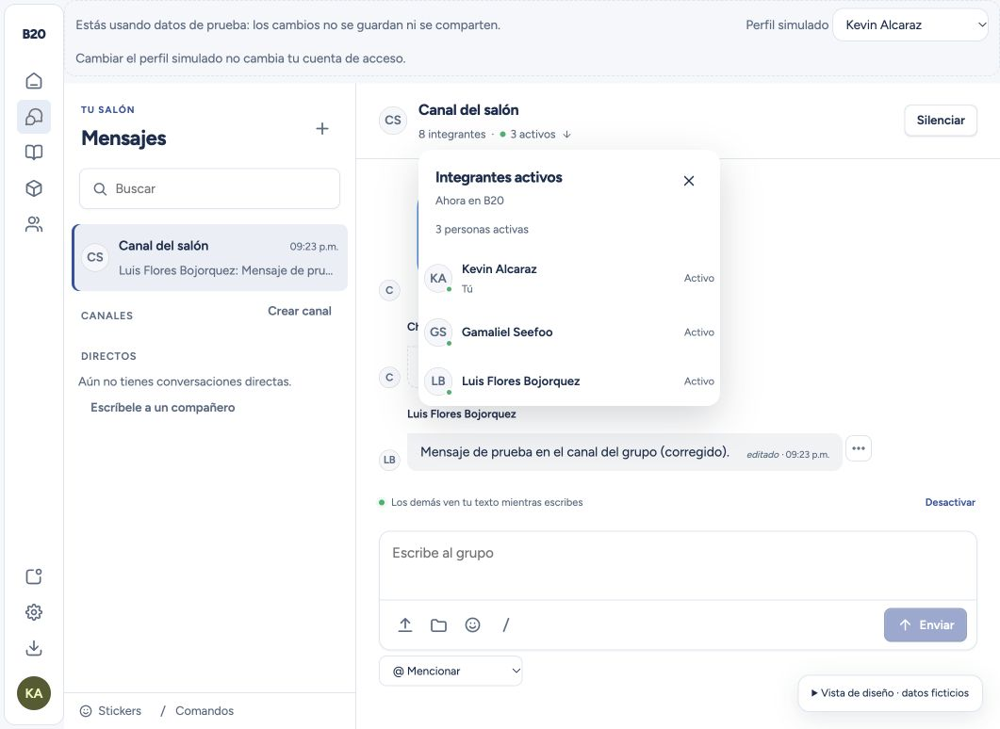
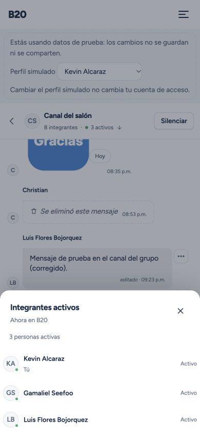
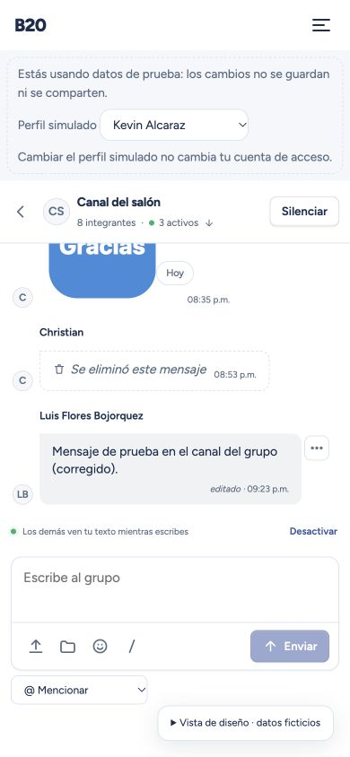

# Integrantes activos en Mensajes

La cabecera del salón muestra el total de integrantes con acceso y el número de personas que tienen B20 visible y en primer plano: **7 integrantes · 3 activos**. El contador abre una lista de solo los activos, con nombre y avatar, que se actualiza sin recargar. Incluye al propio usuario y cuenta una sola vez a quien tiene varias sesiones.

Cambiar entre módulos de B20 conserva la presencia. Ocultar, minimizar, cambiar a otra aplicación, cerrar B20 o cerrar sesión la retira. En Android se utiliza el estado nativo de la aplicación; abrir el teclado no se interpreta como salir de B20. La lista se presenta en un desplegable en escritorio y un diálogo adaptado en móvil, con navegación por teclado y restauración del foco.

## Funcionamiento

- La sesión se registra después de cargar la conexión y comprobar una membresía activa. Una llamada técnica o la autenticación por sí sola no cuenta como actividad.
- El servidor obtiene la identidad de la sesión y la vincula a su integrante canónico. Solo los integrantes activos pueden consultar la proyección de personas conectadas; no se exponen identificadores de conexión ni fechas de actividad.
- Cada sesión renueva su presencia cada 5 segundos. Al salir se envía la retirada inmediatamente; el manejador de desconexión también elimina esa sesión y conserva la limpieza anterior de escritura y borradores.
- Las revisiones crecientes impiden que un pulso atrasado reactive una sesión retirada o caducada. Cerrar una sesión mantiene activa a la persona si tiene otra en primer plano.
- Cuando se pierde internet sin aviso, la detección depende del transporte y de una caducidad de 15 segundos desde la última confirmación. No se promete una retirada instantánea ante una pérdida de red silenciosa.
- Una baja revoca inmediatamente la presencia y su consulta. La presencia no crea mensajes, notificaciones ni un historial de “última conexión”. El servidor conserva únicamente el estado transitorio necesario para ordenar eventos de una conexión.
- Sin conexión, la cabecera indica **Sin conexión** y conserva el último total conocido. Un cero significa realmente que no hay personas activas, no que la consulta haya fallado.

## Validación

La prueba reproducible `npm run test:spacetime:presence` inicia un servidor local aislado con varias cuentas sintéticas. Comprueba entradas y salidas, varias sesiones, identidades vinculadas, bajas, privacidad, revisiones atrasadas, renovación, caducidad y limpieza de presencia, escritura y borradores.

Las pruebas del cliente cubren foco, visibilidad, eventos nativos de Android, cierre, reconexión, temporizadores y limpieza de suscripciones. La demo utiliza sesiones independientes con las mismas reglas; sus pulsos de renovación no reconstruyen los datos generales cuando la lista no cambia.

La publicación se prepara desde una copia aislada y conserva Mensajes, Señales y el Laboratorio visual ya publicados. Antes de publicar se compara el esquema y se ensaya la actualización sobre datos sintéticos poblados. Después se comprueban las huellas de datos y los archivos públicos del sitio.

## Entrega verificada

Publicado el **26 de octubre de 2026** en [Mensajes](https://b20.mx/#/m/mensajes), primero el servidor y después la interfaz. Se conservaron Mensajes, Señales, el Laboratorio visual y los cambios locales previos.

- **2,501 pruebas aprobadas:** 1,364 de interfaz, 251 de core, 557 de servidor, 265 de API y 64 de web. Se limitaron los trabajadores a dos y el tiempo de cada prueba de interfaz a 15 segundos para controlar la carga del equipo.
- Tipos aprobados en todos los paquetes y nuevamente en el servidor final. Compilaciones aprobadas de web/PWA, extensión, Pages y cliente web en modo Capacitor; comprobaciones de compilación de ambas API sin publicar esos servicios.
- La prueba final con varias cuentas en servidor aislado midió **45 ms al entrar**, **48 ms al ocultar** y **32 ms al desconectar**. La sesión sin renovaciones caducó a los **14,994 ms**. Las cuentas con renovaciones siguieron activas.
- El ensayo de actualización conservó las huellas de las **193 tablas existentes y 34 registros sintéticos**, tanto después de actualizar como tras reiniciar. Solo se añadieron dos tablas privadas, dos operaciones y la vista autorizada `online_members`.
- Producción pasó de 193 a 195 tablas y conservó los **524 registros existentes inmediatamente antes de publicar**. Las huellas de 192 tablas permanecieron idénticas; el único cambio fue el cursor del servicio habitual de recordatorios. Durante la preparación habían aparecido siete registros operativos normales de Mensajes, respecto a los 517 del inicio, sin modificaciones de contenido.
- Los **31 archivos públicos** coinciden con la compilación congelada. Las rutas principales y la salud de la API responden correctamente. Proyecto, rama, dominios y configuración de Pages se conservaron.
- Android se comprobó mediante pruebas de sus eventos nativos y compilación en modo Capacitor. No se probó un dispositivo físico ni se distribuyó un APK nuevo.

Despliegue de Pages: `763c2875-031f-46e9-acdf-ca7b6cb9be43`. SHA-256 del servidor ensayado y publicado: `1bd45a6985ec637aba7071828bc8fb889645ff19d2f25a9b3031cdec61fabc00`. Comprobantes locales completos en `artifacts/presencia-2026-10-26/`, sin contenido de los registros de producción.

Las capturas siguientes utilizan únicamente datos ficticios:

